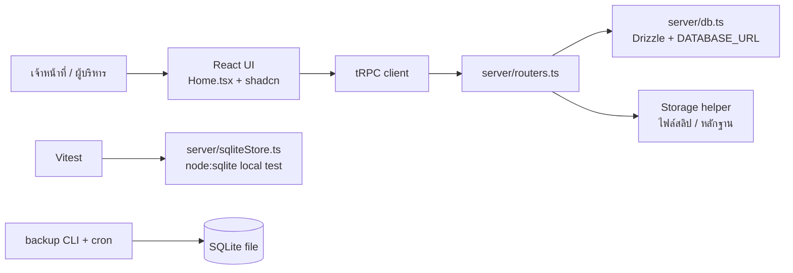

# Architecture and Workflows

## ภาพรวม

โปรเจกต์ใช้ React 19 และ Tailwind CSS ฝั่ง client, Express และ tRPC ฝั่ง server และมี Drizzle เป็นชั้นเข้าถึงฐานข้อมูลหลักของ template โครงสร้างนี้แบ่ง frontend, API contract และ persistence ออกจากกันเพื่อให้ค่อย ๆ ย้ายจาก mock data ไปสู่ database จริงได้โดยไม่ต้องรื้อหน้าเว็บทั้งหมด

## เส้นทางการทำงานสำคัญ

### การขายสินค้า

1. เจ้าหน้าที่ค้นหาหรือสแกนสินค้าใน POS
2. UI รวมรายการซ้ำเป็นจำนวนเดียวและคำนวณยอดรวม
3. ระบบเลือกวิธีชำระเงินเป็นบัญชีสมาชิก เงินสด หรือ QR
4. หลังชำระเงินจะแสดง receipt preview
5. ระบบจริงต้องบันทึก sale, stock movement, payment และ audit log ใน transaction เดียว
6. UI แสดงผลใบเสร็จและดาวน์โหลดไฟล์ได้

### เติมเงินและถอนเงิน

การเติมเงินต้องเก็บสมาชิก ผู้ฝาก วิธีชำระเงิน จำนวนเงิน และหลักฐานการโอนถ้ามี การถอนต้องเก็บสมาชิก จำนวนเงิน วิธีชำระเงิน หมายเหตุ และหลักฐานถ้ามี งาน production ควรตรวจ balance และสิทธิ์ใน server ก่อน commit ทุกครั้ง

### สมาชิก

หน้ารายการสมาชิกมี search และ status filter ส่วนหน้ารายละเอียดแสดงประวัติธุรกรรมที่เกี่ยวข้องกับสมาชิกหนึ่งราย การระงับสมาชิกเป็น destructive action จึงต้องมี confirmation ที่ UI และตรวจสถานะซ้ำใน server

### สต็อก

การรับเข้าสินค้าต้องรองรับ lot, วันหมดอายุ, หน่วยรับเข้า และหน่วยขาย กรณีรับเป็นถุงแต่ขายเป็นชิ้นควรเก็บ conversion rule แยกจากยอดคงเหลือ เพื่อให้การนับสต็อกและต้นทุนไม่คลาดเคลื่อน

## สิทธิ์การใช้งาน

| บทบาท | ควรทำได้ |
| --- | --- |
| เจ้าหน้าที่ | ขายสินค้า, รับ/ถอนเงินตามสิทธิ์, ดูรายการที่จำเป็น, จัดการงานหน้าร้าน |
| ผู้บริหาร | ดู dashboard, รายงาน, กำไรขาดทุน, สต็อก, ตั้งค่า และอนุมัติรายการสำคัญ |

การซ่อนเมนูใน client ไม่ใช่การรักษาความปลอดภัย ต้องเพิ่ม `protectedProcedure` หรือ `adminProcedure` ใน server router และตรวจ role ทุก mutation ที่กระทบเงิน สมาชิก สต็อก หรือการตั้งค่า

## สถานะข้อมูลในปัจจุบัน

`Home.tsx` เป็น prototype page ที่รวมหลายมุมมองไว้ในไฟล์เดียวเพื่อเร่งการออกแบบ workflow ส่วน `server/sqliteStore.ts` เป็น local test adapter แยกต่างหากและยังไม่ได้เป็น persistence path ของทุก interaction ใน UI ทีมถัดไปควรแยกหน้าเป็น `Dashboard`, `Pos`, `Members`, `Stock`, `Reports` แล้วสร้าง tRPC router ทีละ domain

## แผนย้ายไป production database

1. เพิ่มตารางธุรกิจใน `drizzle/schema.ts`
2. สร้าง migration ด้วย `pnpm drizzle-kit generate`
3. ตรวจ SQL และ apply ผ่าน workflow ของ WebDev
4. เพิ่ม query helpers ใน `server/db.ts`
5. เพิ่ม protected/admin procedures ใน `server/routers.ts`
6. เปลี่ยน UI จาก mock constants เป็น `trpc.*.useQuery/useMutation`
7. เพิ่ม test สำหรับ permission, money calculation, stock movement และ idempotency
8. เพิ่ม audit log ในทุก mutation ที่กระทบข้อมูลสำคัญ

## การเก็บไฟล์

ไฟล์สลิปและหลักฐานไม่ควรเก็บเป็น BLOB ใน database ให้ upload ไป storage แล้วเก็บเฉพาะ URL หรือ object key ใน database จำกัดชนิดไฟล์ ขนาดไฟล์ และสิทธิ์การเข้าถึง พร้อมกำหนด retention ตามนโยบายของหน่วยงาน

## Observability และ audit

ทุก mutation สำคัญควรสร้าง log ที่มี actor, action, entity, entity ID, request ID, createdAt และผลลัพธ์ หลีกเลี่ยงการเขียนเลขบัตรประชาชนเต็มหรือข้อมูลสลิปลง log การรายงานอัตโนมัติควรบันทึกสถานะส่งสำเร็จและ error โดยไม่ใส่ secret ในข้อความ error

## References

[1]: https://nodejs.org/api/sqlite.html "Node.js SQLite API"
[2]: https://trpc.io/docs "tRPC Documentation"
